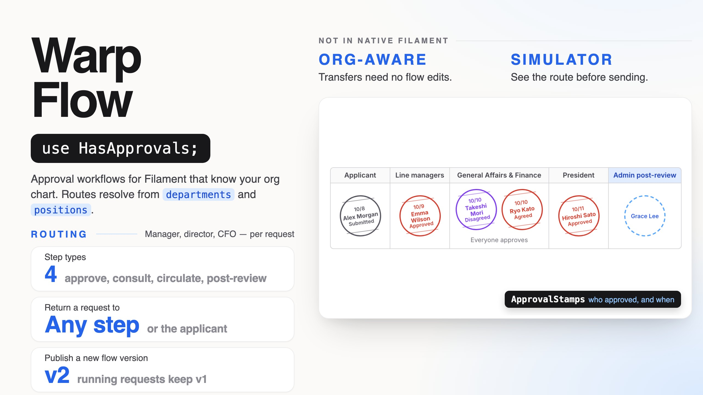
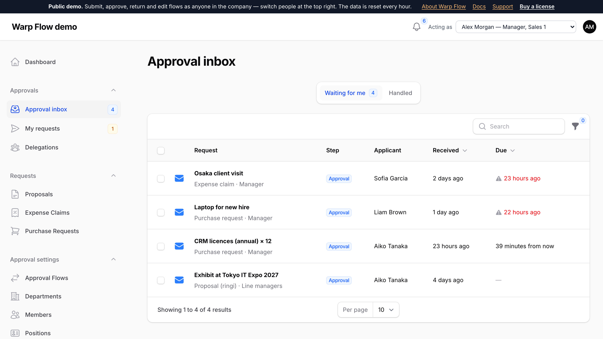
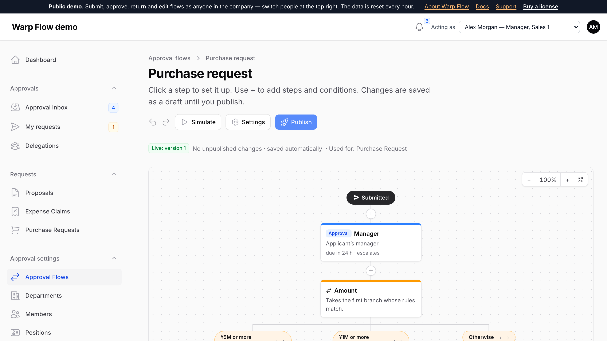
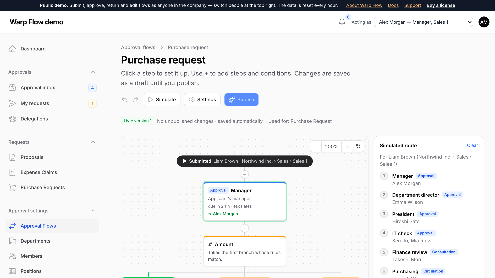
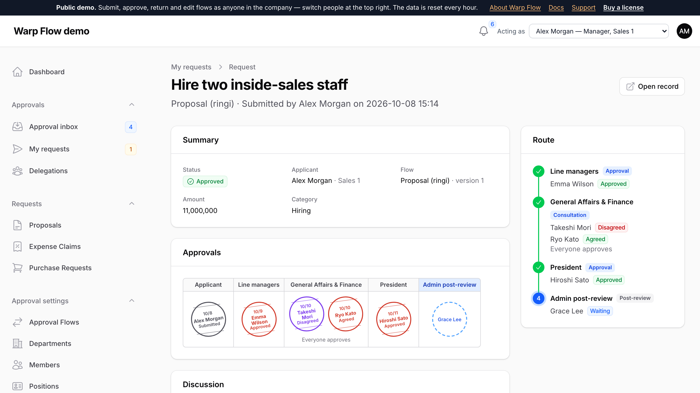
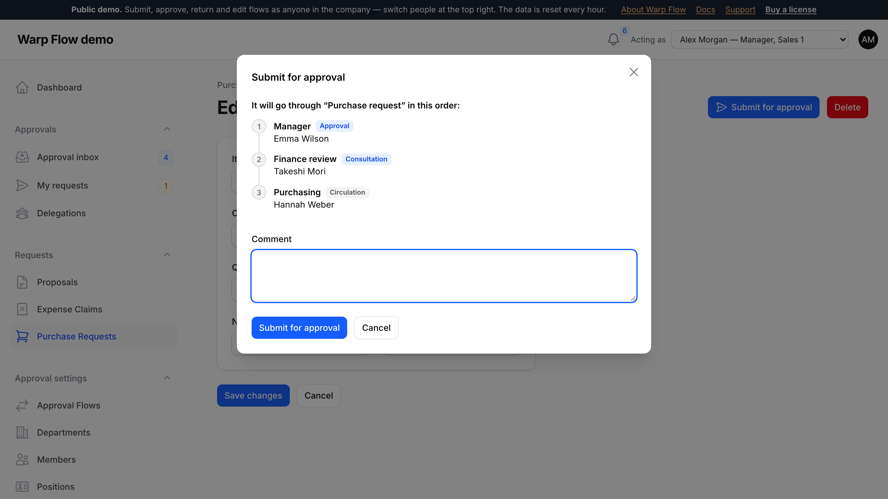

# Warp Flow

**Approval workflows for Filament that know your organization. “The applicant’s manager, then the department director, and the president above ¥5M” is worked out for every request from your departments and positions — with return to any step, consultation, circulation, delegation, due times, hanko-style approval stamps, a route simulator and a discussion thread per request.**

<a href="https://demo.warpui.com/flow"></a>

Submit a purchase request, switch to the manager to return it with a question, answer in the thread, resubmit and approve it — then change the flow and simulate who it would go to — at **[demo.warpui.com/flow](https://demo.warpui.com/flow)**. No sign-up needed; the data is reset every hour.



- [What it does](#what-it-does)
- [Installation](#installation)
  - [AI coding assistants (Laravel Boost)](#ai-coding-assistants-laravel-boost)
- [Quick start](#quick-start)
- [The organization](#the-organization)
- [Flows](#flows)
- [Approvers](#approvers)
- [Conditions](#conditions)
- [Step types](#step-types)
- [Returning and resubmitting](#returning-and-resubmitting)
- [Request forms](#request-forms)
- [The pages](#the-pages)
- [On your record pages](#on-your-record-pages)
- [Record threads](#record-threads)
- [Due times and escalation](#due-times-and-escalation)
- [Delegation](#delegation)
- [Out of office](#out-of-office)
- [Notifications](#notifications)
- [Answering from the email](#answering-from-the-email)
- [Events](#events)
- [Who can see and manage what](#who-can-see-and-manage-what)
- [Plugin options](#plugin-options)
- [Using your own organization data](#using-your-own-organization-data)
- [Using the engine from code](#using-the-engine-from-code)
- [Multi-tenancy](#multi-tenancy)
- [Testing](#testing)
- [Requirements](#requirements)

## What it does

| | |
| --- | --- |
| **Routes from the org chart** | Approvers are relative to the applicant: their manager, the manager two levels up, managers in turn up to a director, the finance manager. Concurrent posts and dated transfers are understood, so nobody edits a flow when people move. |
| **An authority matrix in the flow** | Branch on the amount, the category, the applicant’s department or rank — only fields your model declares. |
| **Real approval etiquette** | Approval, consultation (an opinion that cannot block), for information, post-review. Parallel steps where everyone, anyone or N people must approve. Return to the applicant or to any earlier step. |
| **No surprises** | The submit dialog and the route simulator show exactly who a request goes to, in order, before anything is sent. The route is fixed at submission. |
| **Talk where you approve** | Each request has a thread with @mentions and attachments, in one timeline with the approvals, returns and opinions. An approval inbox shows what waits for you, unread first and by due time. |
| **Requests without code** | Build an expense claim, leave or purchase form from fields in the admin screens; people file requests with it, and its fields drive the flow — no model needed. |
| **Answer anywhere** | Approve or return straight from the email, print or save the request as a ringi-sho PDF with its stamps, and an absent approver’s requests go to their manager on their own. |
| **See where it stalls** | An analytics page shows the steps where requests wait longest and who they wait on, and an org chart shows the organization the routes come from. |
| **Safe to change** | Flows have versions; publishing a new one never changes requests already running. Every action is in an append-only audit log. |



## Installation

> **Warp Flow is a commercial plugin.** A license is required. After purchase you receive credentials for the private Composer repository.

Add the repository and authenticate:

```bash
composer config repositories.qalainau composer https://qalainau.privato.pub/composer
composer config --auth http-basic.qalainau.privato.pub "your-email" "your-license-key"
```

Install the package, run the migrations and publish Filament's assets:

```bash
composer require qalainau/filament-warp-flow
php artisan migrate
php artisan filament:assets
```

The migration creates the `warp_flow_*` tables (organization, flows, requests, tasks, threads, audit log). Your tables are not changed. The `warp_flow_*` tables reference each other with foreign keys: deleting a request also deletes its tasks, comments, read marks and audit log, deleting a thread deletes its comments and followers, and a flow with requests or a department with sub-departments or members cannot be deleted. Deleting a position clears it from its members. To edit the migration, publish it with `php artisan vendor:publish --tag=filament-warp-flow-migrations`. Publish it before you run `php artisan migrate` for the first time: Warp Flow then runs your copy instead of its own. If the tables already exist, change them with a migration of your own instead.

> Run `php artisan filament:assets` again after every update of the package.

Warp Flow sends [Filament database notifications](https://filamentphp.com/docs/5.x/notifications/database-notifications). If the panel does not use them yet, add `->databaseNotifications()` to it and create the `notifications` table (`php artisan make:notifications-table && php artisan migrate`).

### AI coding assistants (Laravel Boost)

Warp Flow ships instructions for AI coding assistants such as Claude Code, Cursor and Codex. If your app uses
[Laravel Boost](https://laravel.com/docs/boost), the assistant learns how to use Warp Flow from them: how to make a
model approvable and declare the fields flows branch on, that a step with nobody to approve it stops the submission,
that follow-up work belongs in an `ApprovalApproved` listener, what is easy to get wrong, and how to test approvals.

- **Guidelines** (`resources/boost/guidelines/core.md`): a short summary that Boost adds to `CLAUDE.md`,
  `AGENTS.md` and the other agent files. It also points the assistant to this README in `vendor/`, so it reads the
  documentation of the version you have installed instead of guessing.
- **Skill** `warp-flow-development` (`resources/boost/skills/`): the steps for making a model approvable, reacting to
  approvals, custom approvers, submitting from code, and feature tests. The assistant loads it when it works on
  approvals.

Boost does not add guidelines of other vendors' packages on its own. When `php artisan boost:install` asks
"Which third-party AI guidelines/skills would you like to install?", select `qalainau/filament-warp-flow`. To do
it without the question, add the package to `boost.json` and run the command again:

```json
{
    "packages": ["qalainau/filament-warp-flow"]
}
```

```bash
php artisan boost:install --guidelines --skills -n
```

## Quick start

**1. Register the plugin** and list the models that can be approved:

```php
use Qalainau\FilamentWarpFlow\FilamentWarpFlowPlugin;

public function panel(Panel $panel): Panel
{
    return $panel
        // ...
        ->databaseNotifications()
        ->plugin(
            FilamentWarpFlowPlugin::make()
                ->models([PurchaseRequest::class, ExpenseClaim::class])
                ->canManage(fn (User $user) => $user->is_admin),
        );
}
```

This adds, under **Approvals**: the approval inbox, *My requests* and *Delegations*; and under **Approval settings**: departments, positions, members and flows. The models are named after the panel’s resource for them (its model label, so translated names show), or after the class name when there is none.

**2. Make your model approvable.** Implement `Approvable`, use `HasApprovals`, and declare the fields conditions may look at:

```php
use Qalainau\FilamentWarpFlow\ConditionField;
use Qalainau\FilamentWarpFlow\Concerns\HasApprovals;
use Qalainau\FilamentWarpFlow\Contracts\Approvable;

class PurchaseRequest extends Model implements Approvable
{
    use HasApprovals;

    public static function approvalConditionFields(): array
    {
        return [
            ConditionField::number('amount', 'Amount'),
            ConditionField::select('category', 'Category', PurchaseCategory::class),
            ConditionField::user('project_manager_id', 'Project manager'),
        ];
    }
}
```

**3. Put the actions on the record’s page.** `ApprovalActions::make()` returns every approval action; each one shows only when the current user can use it right now:

```php
use Qalainau\FilamentWarpFlow\Actions\ApprovalActions;

class EditPurchaseRequest extends EditRecord
{
    protected function getHeaderActions(): array
    {
        return [...ApprovalActions::make(), DeleteAction::make()];
    }
}
```

**4. Set up the organization and a flow** in the panel (*Approval settings*): add departments, positions and members, then create a flow for *Purchase Request*, add steps in the editor and press **Publish**.

That’s it: “Submit for approval” appears on the record, the approvers get it in their inbox and a notification, and the record shows its stamps.

A request is made from the record **as saved**: the route in the *Submit for approval* dialog and the request itself use the saved values. If the edit form has changes that are not saved yet, the dialog says so and asks to save first.

## The organization

Three small tables describe who reports to whom:

| | |
| --- | --- |
| **Departments** | A tree (`parent`). A department’s *head* is its member with the most senior position. |
| **Positions** | A name and a **rank** — higher is more senior (for example President 100, Director 50, Manager 30, Staff 10). |
| **Members** | A person in a department with a position. One person can have several (a *main post* and concurrent posts). Each has an optional *from* and *until* date, so a transfer is the old post ending and the new one starting. |

**The manager** of a person is the member of the same department with the next higher rank. If nobody in the department ranks higher (they are its head), it is the head of the parent department, then the one above. A member’s *Manager* field overrides this for one person.

When someone with several posts submits a request, they choose which department they submit as (the main post is preselected); the route is worked out from that department.

Everything is answered **for the day of submission**, so a transfer scheduled for next month changes routes from next month on.

### The org chart

*Org chart* (under *Approval settings*) draws the departments from top to bottom, each with its head and members, as of the day you pick: concurrent posts are in italics and marked “also in another department”, a department with sub-departments shows how many people it has itself and how many with the departments below (a note above the chart says that a person with posts in two departments is counted once), a member’s own manager and the end of a dated post are noted under their name. When all the sub-departments of a department have none of their own, they are stacked under it instead of side by side, so a wide organization still fits the page. Type a name in *Find a person* to highlight them. Click a department to edit it. Since “the manager” and “the head” in a route come from this organization, it is the quickest way to see why a request went to someone.

The page is for the people `canManage()` allows. To show it to everyone:

```php
FilamentWarpFlowPlugin::make()->canViewOrgChart(fn (User $user) => true)
```

### Importing the organization

*Members* → **Import** → *Import from CSV or Excel* takes a CSV file, or rows pasted from Excel or Google Sheets (tab-separated), with a header row and **one row per person and department**:

| Column | |
| --- | --- |
| `department` | Required. The path from the top: `HQ / Sales / Sales 1` (`/`, `>` and `›` all work). Missing departments are created under their parent. |
| `department_code` | The department’s code (optional). |
| `position` | The position’s name. A new name creates the position with `rank`. |
| `rank` | A whole number; used only when the position is new. |
| `email` | Required. The person, matched on the user’s `email` — or another column set with `importUserColumn('employee_code')`. |
| `primary` | `yes` / `no`. When empty, a person’s first row is their main post and the others are concurrent posts. |
| `starts_on`, `ends_on` | Dates (`2026-04-01`, `2026/4/1` or `2026年4月1日`). |
| `manager` | The email of a manager who overrides the department’s chain of command. |

Japanese headers work too (`部門`, `部門コード`, `役職`, `順位`, `メール`, `主務`, `開始日`, `終了日`, `上長`), and so do Shift_JIS files saved by Excel. A person already in a department is **updated**, not added twice, so you can keep a master sheet and import it again after every reorganization. **Nothing is written if any row has a problem** — the message lists the rows (“Row 4: nobody found for “jo@example.com””). *Download a sample CSV* gives a file to start from (in the other languages its headers stay in English, which the import reads in every language). In a tenant panel, only the tenant’s people are found and everything is created in the tenant.

## Flows

A flow is drawn from top to bottom: steps one under another, and **conditions** that split into branches side by side and join again below. Open a flow from *Approval flows* to edit it:



- **+** between two nodes adds a step (approval, consultation, for information, post-review) or a condition.
- Click a step to set its approvers and rules in a slide-over; click a branch to set its condition.
- Hover a node for *move up/down*, *duplicate* and *delete*. Undo and redo (⌘Z / ⇧⌘Z) cover every change.
- Ctrl/⌘ + wheel zooms, dragging the background pans, and the zoom buttons fit the flow to the screen.
- Every change is saved to a **draft version** at once. **Publish** makes it the version new requests use; requests already running keep the version they started with. *Discard changes* goes back to the published version. Problems that block publishing (a step without approvers, a branch without rules) are listed above the editor and outlined on the flow.
- If someone else changes the same draft, your editor tells you and reloads theirs instead of overwriting it.

**Which flow is used.** A flow has *Used for* (a model, or any record), a **priority** and optional **Use this flow when** conditions. On submission, the flows for the record’s model are checked from the lowest priority number and the first whose conditions match is used. To pick a flow in code, give it a **key** and pass it to the action: `SubmitForApprovalAction::make()->flow('capex')`.

**After a return**, a resubmitted request either resumes at the step that returned it (default) or starts again from the first step — a setting on the flow.

### Starting from a template

A new flow does not have to start empty. On **New approval flow**, **Start from** offers templates next to *An empty flow*; the one you choose fills the draft with steps, and the editor opens on them. On a flow that is still empty, **Start from a template** in the editor does the same (and *Undo* empties it again).

| Template | Steps |
| --- | --- |
| **Manager approval** | The applicant’s manager. |
| **Manager, then the manager’s manager** | Two steps. For an applicant with nobody two levels up (a director), the second step is skipped. |
| **Every manager up to the top** | One step per manager, from the applicant’s manager to the top. |
| **Branch on the amount** | The manager; when the amount is 100,000 or more, the manager’s manager too. |
| **Purchasing** | The manager; when the amount is 1,000,000 or more, every manager above in turn; then the head of the applicant’s department is informed (a for-information step). |

The templates only use approvers that are relative to the applicant, so they work with any organization. The two that branch on an amount are offered when the records chosen under **Used for** have a number field (`ConditionField::number()`, or a *Number* field of a request form); the branch uses the first one, and its name and the amounts are yours to change in the editor. A template gives you a **draft**: check each step, then press **Publish**.

Add your own templates on the plugin. The steps are the nodes of the flow’s graph, without ids:

```php
FilamentWarpFlowPlugin::make()
    ->flowTemplate('contract', 'Contract review', [
        ['kind' => 'approval', 'name' => 'Legal', 'approvers' => [['type' => 'custom', 'key' => 'legal']]],
        ['kind' => 'approval', 'name' => 'Manager', 'approvers' => [['type' => 'manager']], 'due_days' => 2],
        ['type' => 'condition', 'name' => 'Value', 'branches' => [
            ['name' => 'Over 10M', 'when' => ['match' => 'all', 'rules' => [['field' => 'amount', 'op' => '>', 'value' => 10000000]]], 'steps' => [
                ['kind' => 'approval', 'name' => 'Board', 'approvers' => [['type' => 'manager_chain']], 'if_empty' => 'skip'],
            ]],
            ['name' => 'Otherwise', 'steps' => []],
        ]],
    ], 'Legal first, then the manager; the board above ¥10M')
    ->builtInFlowTemplates(false);   // only your own templates
```

| Argument | |
| --- | --- |
| `$key` | A name for the template, unique among the templates. A key that is also a built-in key (`manager`, `two_levels`, `chain`, `amount`, `purchase`) replaces that template. |
| `$label` | The name in the list. A string, or a closure called when it is shown (for `__()` in the user’s language). |
| `$steps` | An array of nodes, or a closure that returns one; the closure can take `$model` (the model class or the request form’s type chosen under *Used for*). A step node takes the keys of a step (`kind`, `name`, `approvers`, `mode`, `due_days`, `if_empty`…; see [Approvers](#approvers) for `approvers`); what you leave out gets the editor’s defaults. A node with `'type' => 'condition'` has `branches`, each with a `name`, a `when` (leave it out for *Otherwise*) and its own `steps`. |
| `$description` | Optional. Shown under the name. A string or a closure. |

Ids are assigned each time a template is used, so one template can start any number of flows. The template key that comes from the browser is checked against the templates offered for that flow’s records; anything else is refused.

### The route simulator

Press **Simulate**, pick an applicant (and their department) and fill in the record’s fields. The route is drawn on the flow — the branch taken in green, the people on each step, skipped steps faded — and listed on the right. It follows the draft you are editing and redraws after each change. Nothing is saved.



## Approvers

A step’s approvers are one or more of:

| Approvers | Who |
| --- | --- |
| **Applicant’s manager** | The applicant’s manager; *Levels up* = 2 is the manager’s manager. |
| **Managers in turn, up to a position** | One step per manager, going up until the first person with the chosen position or higher (for example “up to Director”). Empty goes to the top. If the applicant already holds that position, the step is skipped. |
| **Position holder** | Everyone with that position in a chosen department, or — without a department — in the applicant’s department or the nearest one above it that has one (“the director of the applicant’s division”). |
| **Head of a department** | The head of a chosen department, or of the applicant’s own (their manager if they are the head). |
| **Specific people** | Named users. |
| **Person in a record field** | A user id stored on the record — a field declared with `ConditionField::user()`. |
| **Custom** | Your own rule, registered with `approverResolver()` (see [Plugin options](#plugin-options)). |

Approvers are resolved **when the request is submitted** and stored with it, so the people do not change while it is under way. After a transfer, a manager can press **Recalculate approvers** on the request to work the approvers out again from today’s organization (finished steps stay as they are).

On each step:

- **Who must act** — *everyone*, *any one of them* or *a number of them* (when a step has several people). When enough people have approved, the others’ tasks are dropped.
- **Skip the applicant** (on by default) — the applicant never approves their own request; if nobody else is left, the step is skipped.
- **Skip people who already approved** (on by default) — someone who approved an earlier step of the same request is not asked again.
- **If nobody is found** — stop the submission with an error, or skip the step. See [When nobody is found](#when-nobody-is-found).
- **Can return the request** — whether approvers of this step may return it.
- **Due within**, **Remind before the due time**, **When the due time passes** and **Repeat the reminder every** — see [Due times and escalation](#due-times-and-escalation).

### When nobody is found

Sometimes a step has nobody to send it to: the applicant has no manager (the president), the record field is empty, a custom resolver returns no one, or everyone it returns is outside the tenant. What happens then is the step’s **If nobody is found** setting:

| Setting | What happens | Default for |
| --- | --- | --- |
| **Stop the submission with an error** | The request is not sent. The applicant sees “Nobody can be found for step “Finance”, so the request can’t be sent. Ask whoever manages the approval flows to set who handles this step.” Nothing is saved, so they can submit again once the flow or the organization is fixed. | Approval steps |
| **Skip this step** | The request moves on without this step. | Consultation, for-information and post-review steps |

Approval steps stop by default so that a mistake in the approvers (a resolver that looks in the wrong place, an empty department) can never turn into a request that is **approved without anyone approving it**. A step saved without the setting (a graph written in a seeder, for example) gets the default of its type.

Choose **Skip this step** only where an empty step is expected — typically *Applicant’s manager* or *Managers in turn* on a flow the president or the directors also use, since there is nobody above them. When an approval or consultation step is skipped because nobody was found, Warp Flow still makes it stand out:

- the request page says so in the summary (“Approved, but nobody approved “Owners”: nobody was found for that step, so it was skipped.”) and marks the step in the route;
- the timeline marks the “was skipped” line with a warning;
- the route simulator warns “Nobody can be found for “Owners”, so it would be skipped: nobody approves it.” — and shows “the request would stop here” on steps that stop.

Steps left empty because the only approver is the applicant (**Skip the applicant**) or already approved earlier (**Skip people who already approved**) are skipped quietly, as before.

Use the simulator with a few applicants (someone at the top, someone in each department) before you publish a flow.

```php
// In a seeder: the manager step is skipped for the president, the finance step must always find someone
['id' => 'manager', 'type' => 'step', 'kind' => 'approval', 'name' => 'Manager',
    'approvers' => [['type' => 'manager', 'levels' => 1]], 'if_empty' => 'skip'],
['id' => 'finance', 'type' => 'step', 'kind' => 'approval', 'name' => 'Finance',
    'approvers' => [['type' => 'custom', 'key' => 'finance']]],   // no if_empty: stops if nobody is found
```

## Conditions

Conditions — in a branch and in *Use this flow when* — compare:

- the fields the model declares in `approvalConditionFields()`, and
- **Applicant’s department** (*is in*, including the departments under it) and **Applicant’s position rank**.

Nothing else is evaluated: no expressions, no attributes the model does not declare. Rules are combined with *all* or *any*. Branches are checked from left to right; the first that matches is taken, and an *Otherwise* branch (always last) catches the rest. If no branch matches, the condition adds no steps.

`ConditionField` types:

```php
ConditionField::number('amount', 'Amount');                          // ≥ > ≤ < = ≠, empty
ConditionField::select('category', 'Category', Category::class);     // = ≠, one of, none of — options from an array or a backed enum
ConditionField::text('vendor', 'Vendor');                            // = ≠, contains, empty
ConditionField::boolean('is_capex', 'Capital expenditure');          // yes / no
ConditionField::user('project_manager_id', 'Project manager');       // = ≠ a user; also usable as approvers
```

`getValueUsing()` reads a value from elsewhere, for example a relation:

```php
ConditionField::select('department', 'Cost center', CostCenter::pluck('name', 'id')->all())
    ->getValueUsing(fn (PurchaseRequest $record) => $record->costCenter?->id);
```

The same fields make the summary on the request page. Override `approvalSummary()` to show something else, and `approvalTitle()` for the request’s title (by default the `title`, `name` or `subject` attribute).

## Step types

| Type | What it does |
| --- | --- |
| **Approval** | Approve, return or reject. The request waits until the step is complete. |
| **Consultation** | Agree or disagree with a comment. The request waits for the opinions, but a disagreement does not stop it — it stays on the record (and on the stamps) for the approvers who follow. |
| **For information** | Circulation. People get it and mark it as read; the request does not wait. |
| **Post-review** | Sent after the final approval, for people who review afterwards. |

## Returning and resubmitting

An approver can **return** a request:

- **to the applicant** — the request becomes *Returned*; the applicant edits the record and presses **Resubmit**;
- **to an earlier approval or consultation step** — that step starts again and the request moves forward from there.

A reason is required, and it appears in the thread. On resubmission the route is worked out again from the record as it is now. The request resumes at the step that returned it — unless the flow says to start over, or the changes alter the route before that step (a higher amount adding a director, for example), in which case it starts from the first step.

**Reject** ends the request. **Withdraw** lets the applicant take back a request under way. After a request is rejected or withdrawn the record can be submitted again as a new request.

### What changed since the last submission

Every submission keeps the record’s summary values. When a returned request is resubmitted — or a rejected or withdrawn record is submitted again — the approvers see **what changed**: the request page marks the changed fields with the old value struck through (“~~480,000~~ → 398,000”) or says *Nothing changed since the last submission*, the timeline lists the changes under *resubmitted the request*, and the approval email says “Changed: Amount 480,000 → 398,000”.

What is compared is the model’s `approvalSnapshot()` — by default the fields of `approvalConditionFields()`, or those of `approvalSummary()` when you override it. Override it to compare something else:

```php
public function approvalSnapshot(): array
{
    return [
        'total' => ['label' => __('Total'), 'value' => Number::currency($this->total, 'JPY')],
        'lines' => ['label' => __('Lines'), 'value' => $this->lines->map->name->implode(', ')],
    ];
}
```

## Adding an approver, reassigning a step

Two things change who handles the **current** step of a request that is already running. Both are on the request page, and both are written into the request’s history.

### Add an approver (“have this person look at it too”)

The approver whose turn it is — or their delegate — presses **Add an approver**, picks a person and says why. That person joins the same step and is notified at once.

- The step keeps its rule. With *Everyone*, the request moves on only when the added person has approved as well; with *Any one of them*, their approval (or yours) is enough; with *A number of them*, theirs can be one of the approvals needed. The dialog says which applies.
- The added person gets the same due time as the person who added them, can open the request, and is shown on the route as “added by …”. They can approve, return or reject like any approver of the step.
- Who can be added: anyone who can be picked in the panel (in a tenant panel, the tenant’s people) — but not the applicant, and not someone already on the step.
- It works on approval and consultation steps. The addition belongs to this round of the step: if the request is returned and resubmitted, the step is worked out from the flow again.

Everyone whose turn it is can do this by default. Switch it off, or decide per person and request:

```php
FilamentWarpFlowPlugin::make()
    ->addApprovers(false)                                                       // nobody can add approvers
    ->addApprovers(fn (User $user, Instance $instance) => $user->isManager())   // or decide yourself
```

### Reassign a stuck step

When a request waits on someone who cannot answer — they left the company, are on long leave — a flow administrator presses **Reassign**, chooses whose step to take (the people the current step still waits on), who gets it instead, and writes the reason (required).

- The first person’s task is cancelled and they are told; the new person gets the task with a **new due time**, counted from now.
- The history records who reassigned the step, from whom to whom, and the reason.
- The new person cannot be the applicant or someone already on the step, and must be a person who can be picked in the panel (in a tenant panel, one of the tenant’s people).
- For a whole route that is out of date after a reorganization, use **Recalculate approvers** instead: it works every remaining step out again from today’s organization.

**Who can reassign.** The people `canManage()` allows — the same people who edit flows. Name others with `canReassign()`:

```php
FilamentWarpFlowPlugin::make()
    ->canReassign(fn (User $user) => $user->hasRole('approval-admin'))
```

The button is on the request page, so the person also has to be able to open the request: give administrators `canViewAllRequests()` if they should reach requests they are not part of. The permission is checked again when the step is reassigned, not only when the button is drawn, and the task must belong to the request on the page.

On your own record pages, add the two actions next to the others:

```php
use Qalainau\FilamentWarpFlow\Actions\AddApproverAction;
use Qalainau\FilamentWarpFlow\Actions\ApprovalActions;
use Qalainau\FilamentWarpFlow\Actions\ReassignAction;

protected function getHeaderActions(): array
{
    return [...ApprovalActions::make(), AddApproverAction::make(), ReassignAction::make()];
}
```

From code: `app(Engine::class)->addApprover($task, $approver, $person, 'Please check the budget')` and `->reassign($task, $admin, $person, 'Left the company')`. Both throw a `FlowException` with a message for the user when it is not allowed.

## Request forms

Not every request needs a model. With request forms, admins build an expense claim, a leave request or a purchase request **in the admin screens**, and everyone files requests with it:

```php
FilamentWarpFlowPlugin::make()->forms()
```

This adds *Request forms* under *Approval settings* and *Requests* under *Approvals*.

1. **Build the form.** Under *Request forms*, give it a name, a description (shown above the form — what to attach, for example) and its fields: *Text*, *Long text*, *Number*, *Date*, *Choice* (with its choices), *Checkbox*, *Person*, *Files* and *Table of rows* (line items with a total — see [below](#rows-and-a-total)), each optionally required and with a hint. Each field has a **key** (`amount`), made from the label, under which its value is stored; keep it when you rename the label.
2. **Give it a flow.** *Create its flow* opens the editor with a new flow for the form — or choose “Form: Expense claim” as *Used for* on any flow. Number, choice, text, checkbox and person fields — and the **total of a table** — can be used in **conditions** (“Amount ≥ 100,000”), in the **simulator**, and person fields as **approvers** (*Person in a record field*).
3. **File a request.** Under *Requests* → *New request*, people choose the form, write a subject and fill it in, save, and press *Submit for approval*. They can change it while it is a draft or returned to them; the page shows the stamps and the route once submitted.

Approvers open the request from their inbox as usual; *Open record* shows the filled-in form, read-only. A form with requests cannot be deleted — turn *In use* off to stop new requests. Files go to the attachments disk (`attachmentsDisk()`). Forms and requests are kept per tenant.

A form’s requests are `Qalainau\FilamentWarpFlow\Models\FormEntry` records (`$entry->data['amount']`), so you can list or export them, and listen to `ApprovalApproved` to act on them:

```php
Event::listen(ApprovalApproved::class, function (ApprovalApproved $event) {
    if ($event->instance->subject instanceof FormEntry && $event->instance->subject->form->name === 'Expense claim') {
        Payment::schedule($event->instance->subject->data['amount'], to: $event->instance->applicant_id);
    }
});
```

### Rows and a total

A **Table of rows** field puts line items on a form — the lines of an expense claim, the items of a purchase — and adds them up.

1. **Columns.** Give the table its columns: each has a label, a type (*Text*, *Number*, *Date* or *Choice*), a key and can be required. Up to 12 columns.
2. **Total.** Choose how the rows add up:

   | Total | What is added | For |
   | --- | --- | --- |
   | **No total** | Nothing. | A plain list (attendees, serial numbers). |
   | **Add up one column** | One *Number* column. | Expense lines: date, description, **amount**. |
   | **Add up one column × another** | Two *Number* columns multiplied per row. | Purchases: item, **quantity × unit price**. The table gets an *Amount* column for each row. |

3. **Fill it in.** On the request, people press **Add a row** and fill in the columns; rows can be dragged into another order and removed. Each row’s amount and the total under the table are shown again when they leave a number field. A required table needs at least one row; a request holds up to 200 rows.

**The total drives the flow.** A table with a total adds a number field to the form — “Items (total)”, stored as `data.<key>_total` — that works like any number field: in a branch (“Items (total) ≥ 100,000 → the director approves too”), in the conditions that pick the flow, in the simulator, and for the *Branch on the amount* and *Purchasing* [templates](#starting-from-a-template), which use the form’s first number field.

Approvers see the rows as a table under the summary of the request, with the total, and on the printout. When a returned request is resubmitted, a changed table and a changed total are marked like any other changed field, with the rows as they were before.

Good to know:

- **The total is worked out on the server** every time the request is saved, from the rows that were saved — never from what the browser sent. Rows keep only the columns the form defines; values in number columns that are not numbers count as nothing.
- In code, the rows are `$entry->data['items']` (a list of arrays keyed by the column keys, plus `_amount` per row when the table has a total) and the total is `$entry->data['items_total']`. Creating a `FormEntry` from code works the same way: give the rows, the total is filled in.
- A field key cannot end in `_total`, so it can never collide with a table’s total.
- Amounts are rounded to two decimals. There is one total per table; for a second total, add a second table.
- If you later change which columns a table adds up, existing requests get the new total the next time they are saved; requests already submitted keep the route they were given.

```php
// A purchase form with rows, made in a seeder
$form = Form::create(['name' => 'Purchase', 'fields' => [
    ['key' => 'items', 'label' => 'Items', 'type' => 'table', 'required' => true,
        'columns' => [
            ['key' => 'item', 'label' => 'Item', 'type' => 'text', 'required' => true],
            ['key' => 'quantity', 'label' => 'Quantity', 'type' => 'number', 'required' => true],
            ['key' => 'unit_price', 'label' => 'Unit price', 'type' => 'number', 'required' => true],
        ],
        'total_mode' => 'product', 'total_a' => 'quantity', 'total_b' => 'unit_price',   // or 'sum' with total_a, or 'none'
    ],
]]);

// in the flow's graph: the director approves from 100,000
['type' => 'condition', 'name' => 'Total', 'branches' => [
    ['name' => '100,000 or more', 'when' => ['match' => 'all', 'rules' => [['field' => 'data.items_total', 'op' => '>=', 'value' => 100000]]], 'steps' => [/* … */]],
    ['name' => 'Otherwise', 'steps' => []],
]],
```

## The pages

| Page | |
| --- | --- |
| **Approval inbox** | What waits for you (and for the people you stand in for): unread requests in bold, sorted by due time, overdue ones flagged. The *Step* column names the step (“Manager”, “Accounting”) with its type under it. Filter by step type, flow or overdue; **Approve selected** approves approval steps and marks circulations as read in bulk. The *Handled* tab lists what you dealt with. The navigation badge counts what waits. |
| **My requests** | Your requests, where each one is and whose turn it is. The badge counts the ones returned to you. |
| **Delegations** | Let someone approve for you for a period, for every flow or one flow. |
| **Out of office** | Periods when people are away; their approvals go to their manager (see [Out of office](#out-of-office)). |
| **Request** | One request: its summary, the approval stamps (with a key to what the blue, red and grey circles mean), the route with each person’s result and due time, and the thread. The actions you can take now are in the header. **Print / PDF** opens it as an A4 approval record. |
| **All requests** | For auditors and accounting: every request, with filters and a CSV export (see [All requests](#all-requests)). Only for the people `canViewAllRequests()` allows. |
| **Approval analytics** | For managers and auditors (see below). |
| **Org chart** | See [The org chart](#the-org-chart). |



The thread takes comments with **@mentions** (type `@` and a name) and attachments. People mentioned are notified and can open the request even if they are not on its route. The request page reloads every 30 seconds, so a step someone else just finished does not keep its buttons.

### Request numbers

Requests have no number unless you ask for one. With `requestNumber()`, every new request gets a number when it is submitted:

```php
FilamentWarpFlowPlugin::make()
    ->requestNumber()                                        // 2026-00042, starting again at 1 each year
    ->requestNumber('REQ-{Y}-{seq:5}')                       // REQ-2026-00042
    ->requestNumber('{flow}-{y}{m}-{seq:3}', perFlow: true)  // expense-2611-007: per flow, starting again each month
    ->requestNumber('R{seq:6}')                              // R000042, never starting again
    ->requestNumber(fn (Instance $instance, int $sequence, CarbonImmutable $date) => 'D'.$instance->unit_id.'-'.$sequence, reset: 'never')
```

| Argument | |
| --- | --- |
| `$format` | A string of text and placeholders: `{Y}` (four-digit year), `{y}` (two digits), `{m}`, `{d}`, `{seq}` (the running number), `{seq:5}` (padded with zeros to five digits) and `{flow}` (the flow’s key, or its id when it has none). Or a closure that receives `instance`, `sequence` and `date` by name and returns the number. Default `{Y}-{seq:5}`. |
| `$reset` | When the running number starts again at 1: `'never'`, `'year'`, `'month'` or `'day'`. Left out, it follows the format: daily with `{d}`, monthly with `{m}`, yearly with `{Y}` or `{y}`, otherwise never (a closure: yearly). |
| `$perFlow` | `true` gives each flow its own running number. Put `{flow}` in the format, or two flows will hand out the same number. |

The number is stored in `number` on the request (`$record->approval->number`) and shown on the request page, in the inbox, *My requests*, *All requests*, the dashboard lists and the printout; the lists find a request by it.

Good to know:

- **A request keeps its number** when it is returned and resubmitted. A record submitted again after a rejection or a withdrawal is a new request with the next number.
- **No number is given twice.** The running number lives in one row per tenant and period (`warp_flow_counters`, indexed by tenant like the other tables) that is locked while a request is submitted, so two people submitting at the same moment get two numbers, and a submission that fails gives its number back. Numbers of deleted requests are not reused.
- Each tenant has its own running numbers. The year, month and day are those of the app’s time zone.
- Requests submitted before you turned numbering on have no number; lists show “—”, the printout shows the id.
- The number is at most 64 characters. Make sure the format contains what the reset needs — `{seq:5}` alone with a yearly reset repeats `00001` every year.

### All requests

**All requests** lists every request — also the ones the viewer has nothing to do with — with its number, subject, flow, applicant and department, status, the step and the people it waits on, and when it was submitted and closed. It is meant for audits and accounting.

- **Filters**: status, flow, applicant, department, the day of submission (from – until, in the panel’s time zone) and *Overdue now*. The search box looks in the subject and the number. Filters are kept in the URL, so a filtered list can be bookmarked or sent to a colleague (who needs the same permission).
- **Export CSV** saves exactly the requests listed — the same filters, search and order — as a UTF-8 file that Excel opens directly: number, subject, flow, applicant, department, status, step, waiting on, submitted, closed and how often it was submitted. Values that a spreadsheet would run as a formula (starting with `=`, `+`, `-` or `@`) get a leading `'`. One file holds at most 50,000 requests; narrow the list by period for more.
- A row opens the request.

**Who can open it.** Only the people `canViewAllRequests()` allows:

```php
FilamentWarpFlowPlugin::make()
    ->canViewAllRequests(fn (User $user) => $user->hasRole('auditor'))
```

Without `canViewAllRequests()` nobody can open the page, and it is not in the menu. Being allowed to manage flows (`canManage()`) is **not** enough: the list shows the content of every request, which a flow administrator has no reason to read. The page checks the permission again when it exports. In a tenant panel the list and the file hold the current tenant’s requests only. `->allRequests(false)` removes the page from the panel.

### Dashboard widgets

Three widgets put approvals on the panel’s dashboard, so people see what waits for them without opening the inbox:

| Widget | |
| --- | --- |
| `ApprovalStats` | Three numbers: **Waiting for your approval**, **Overdue** (waiting for you and past the due time) and **Returned to you** (your own requests to fix and resubmit). Each one is a link: to the inbox, to the inbox filtered to overdue requests, and to *My requests* filtered to returned ones. |
| `WaitingApprovals` | The five requests waiting for you with the nearest due time, overdue ones first in red. A row opens the request; **See all** opens the inbox. |
| `ReturnedRequests` | Your five most recently returned requests, with who returned each one and their comment. |

Turn them on with one option — they are off unless you ask for them:

```php
FilamentWarpFlowPlugin::make()
    ->dashboardWidgets()
```

To choose which ones to show, or to put them on a page of your own, leave `dashboardWidgets()` out and list the classes yourself:

```php
use Qalainau\FilamentWarpFlow\Widgets\ApprovalStats;
use Qalainau\FilamentWarpFlow\Widgets\WaitingApprovals;

// in the panel provider
->widgets([ApprovalStats::class, WaitingApprovals::class])

// or on a page
protected function getHeaderWidgets(): array
{
    return [ApprovalStats::class];
}
```

Good to know:

- The widgets count and list **only the signed-in person’s own work**: tasks assigned to them (and to people who delegated to them), and requests they submitted. They use the same numbers as the inbox and *My requests* badges. In a tenant panel they count the current tenant only.
- They refresh every 60 seconds, and at once when a request is approved or returned on the same page.
- Set the order among your other widgets by extending a class and changing `protected static ?int $sort` (the defaults are `-3`, `-2` and `-1`, so they come first). Give your own dashboard widgets a `$sort` too: Filament cannot order a widget without one against the others.
- The inbox and *My requests* now keep their filters in the URL (`?filters[overdue][isActive]=1`), which is how the links above work — and why a reload keeps the filter.

### Print / PDF

**Print / PDF** on the request page opens the request as an A4 **approval record** (a ringi-sho): the hanko stamps in a row of boxes, the summary with its changes, a table of every step and person with their result, date and comment, and the whole history with the thread. Press *Print or save as PDF* and choose “Save as PDF” to file it — no PDF library is needed on the server. It can be opened by the same people as the request.

### Approval analytics

*Approval analytics* (under *Approval settings*) is for the people `canManage()` or `canViewAllRequests()` allows. For the last 30, 90 or 365 days, for one flow or all of them, it shows:

- the requests submitted, approved, rejected and open, the approval rate (approved ÷ (approved + rejected) — open and withdrawn requests are left out; the card shows both numbers), the median time from submission to approval, and the tasks overdue right now. Each card says under its number what it counts;
- **where requests wait**: for each step, how many tasks were answered and the average, median and longest wait from a task arriving to its answer, and how often it returned requests — longest first;
- **who they wait on** now: each person with waiting tasks, how many are overdue, and the oldest wait;
- the oldest open requests, with links.

Hide it with `->analytics(false)`.

## On your record pages

### Actions

| Action | Shows when |
| --- | --- |
| `SubmitForApprovalAction` | The record has no request under way. The dialog previews the route; people with several posts choose their department. After a return it becomes **Resubmit** for the applicant. `->flow('key')` picks a flow. |
| `ApproveAction`, `ReturnAction`, `RejectAction` | The current user (or someone they stand in for) has an approval task on the current step. |
| `OpinionAction` | A consultation task. |
| `AcknowledgeAction` | A for-information or post-review task. |
| `WithdrawAction` | The applicant, while the request is under way. |
| `AddApproverAction` | The current user has an approval or consultation task on the current step (see [Adding an approver, reassigning a step](#adding-an-approver-reassigning-a-step)). |
| `ReassignAction` | The request is in review and the current user is allowed by `canReassign()`. |

`ApprovalActions::make()` returns the first seven; add `AddApproverAction::make()` and `ReassignAction::make()` yourself where you want them (the request page has both). They work on any page whose record is approvable, and also take a request (`Instance`) as their record.



### Schema components

```php
use Qalainau\FilamentWarpFlow\Schemas\ApprovalStamps;
use Qalainau\FilamentWarpFlow\Schemas\ApprovalTimeline;

Section::make('Approval')
    ->visible(fn (?PurchaseRequest $record) => $record?->approval()->exists())
    ->schema([
        ApprovalStamps::make(),   // hanko-style stamps of the latest request, with a link to it
        ApprovalTimeline::make(), // the route: done, current (with due times), waiting, skipped
    ]),
```

Both work in forms and infolists.

### Tables

```php
use Qalainau\FilamentWarpFlow\Tables\ApprovalStatusColumn;
use Qalainau\FilamentWarpFlow\Tables\ApprovalStatusFilter;

$table
    ->modifyQueryUsing(fn (Builder $query) => $query->with('approval'))
    ->columns([..., ApprovalStatusColumn::make()])
    ->filters([ApprovalStatusFilter::make()]);
```

The column shows the latest request’s status (*Not submitted* when there is none); the filter includes *Not submitted*.

### On the model

```php
$record->approval;                    // the latest request (Instance), or null
$record->approvals;                   // every request, newest first
$record->approvalStatus();            // ApprovalStatus::Pending / Returned / Approved / Rejected / Withdrawn, or null
$record->isLockedByApproval();        // true while in review or once approved
$record->submitForApproval($user);    // submit from code (see below)

PurchaseRequest::whereApprovalStatus('approved')->get();   // or 'none'
PurchaseRequest::awaitingApprovalFrom($user)->get();
```

Once the latest request is approved, the record page no longer offers *Submit for approval* (a rejected or withdrawn record can be submitted again). To start a new request for an approved record — an amendment, say — call `submitForApproval()` from your own action.

To stop edits while a request is in review, disable the form with `isLockedByApproval()`:

```php
Section::make()->schema([...])->disabled(fn (?PurchaseRequest $record) => (bool) $record?->isLockedByApproval()),
```

## Record threads

Not everything needs an approval. A **record thread** lets people talk on any record — an order, a project, a job — in the same way as on a request: comments with @mentions and attachments, on the record’s own page.

**1. Give the model a thread:**

```php
use Qalainau\FilamentWarpFlow\Concerns\HasThread;

class SalesOrder extends Model
{
    use HasThread;   // with HasApprovals too, if it can also be submitted
}
```

**2. Put the thread on the record’s page** (an infolist or a form):

```php
use Qalainau\FilamentWarpFlow\Schemas\RecordThread;

Section::make('Discussion')->schema([RecordThread::make()]),
```

**3. Optionally, list the threads people follow** with a *Threads* page next to the approval inbox:

```php
FilamentWarpFlowPlugin::make()->threads()
```

How it works:

- The thread is created by the first comment. People who comment and people who are mentioned **follow** it and are notified of later comments; anyone who can read it can press **Follow** or **Unfollow**.
- When the model also uses `HasApprovals`, the thread shows the record’s requests as they happen — submitted, returned, rejected, withdrawn, approved — with a link to the request for the people who can open it. What is said inside a request (its comments, the reason for a return) stays on the request.
- The *Threads* page lists the threads you follow, newest first, with the ones that have new comments in bold and counted on the navigation badge. Opening the record marks its thread as read; the page can also mark threads as read and unfollow them in bulk.
- **Who can read and write** a thread: by default, whoever the model’s policy allows to `view` the record (everyone, if the model has no policy). Change it with `canViewThread()`:

  ```php
  FilamentWarpFlowPlugin::make()->canViewThread(fn (Model $record, User $user) => $user->can('view', $record) || $user->is_manager)
  ```

  The same check is made for each follower before a notification is sent, so people who can no longer see the record are not told about it. Someone mentioned who cannot read the thread is not notified and does not follow it.
- The title in the list and in notifications is the record’s `approvalTitle()` when it also uses `HasApprovals`, otherwise its `title`, `name` or `subject` attribute; override `threadTitle()` on the model to change it.
- Threads are kept per tenant like everything else (see [Multi-tenancy](#multi-tenancy)).

## Due times and escalation

A step’s **Due within** sets a due time on each task, counted in **hours** (calendar hours) or **business days** (at the same time of day: a task that arrives on Friday at 17:00 with *1 business day* is due on Monday at 17:00). The package schedules `warp-flow:check-due` every hour (your app needs the Laravel scheduler running: `* * * * * php artisan schedule:run`).

Three more settings of the step, under **Due time** in the editor, say what happens around that time. All three are empty by default: a step with only a due time reminds the approver once when it is overdue, as before.

| Setting | What it does |
| --- | --- |
| **Remind before the due time** | A number of hours. The approver gets one *Due soon* notification that many hours before the due time (with `emailApproval()`, the email carries the answer link). |
| **When the due time passes** | What happens to an approval or consultation task nobody answered — see the table below. |
| **Repeat the reminder every** | A number of hours. After the due time the approver is reminded again at that interval until they answer. Empty: one reminder only. Not offered for steps that approve or reject automatically, which end at the due time. |

**When the due time passes** has four choices:

| Choice | What happens |
| --- | --- |
| **Only send a reminder** (default) | The approver is notified once. The request keeps waiting. |
| **Pass it to the manager** | The task goes to the approver’s manager: the original task is cancelled and the manager’s task counts for the same step. If there is no manager (or the manager is the applicant or already on the step), the approver is reminded instead. |
| **Approve it automatically** | The task is approved without anyone pressing *Approve*, and the request moves on (or is approved, if this was the last step). Approval steps only. |
| **Reject it automatically** | The request ends as rejected; the applicant and the approver are told. Approval steps only. |

An automatic approval or rejection is **recorded as automatic**, never as the approver’s own decision: the task has `is_automatic` set and no `acted_by`, the audit log gets an `auto_approved` or `auto_rejected` event without a user, the stamp says *Automatic* instead of the approver’s name, and the route, the printout and the approver’s *Handled* tab say “Approved automatically — nobody answered by the due time”. `ApprovalApproved`, `ApprovalRejected` and `StepCompleted` fire as usual, with `actor` set to `null`.

Good to know:

- **Each task is handled once.** The command locks the request and the task, and marks the task before it acts, so two runs at the same time (or a second run later) cannot approve, reject or hand over the same task twice.
- With several approvers on a step (*Everyone*), each overdue task is approved on its own; the step is finished when enough of them are in, whether a person or the due time put them there.
- **Automatic approval lets a request through that nobody read.** Use it for steps where silence means consent (a notice period), and prefer *Pass it to the manager* for real approvals.
- The check runs hourly, so reminders and automatic decisions happen within the hour after their time, not to the minute. Run it by hand with `php artisan warp-flow:check-due`.
- A consultation is an opinion, not an approval: it can be reminded or passed to the manager, but is never approved or rejected automatically.
- Flows saved before these settings keep working: a step with **Pass to the manager when overdue** switched on is read as *Pass it to the manager*.

In code (a seeder or a test), the same settings are keys of the step in the flow’s graph:

```php
['id' => 'manager', 'type' => 'step', 'kind' => 'approval', 'name' => 'Manager',
    'approvers' => [['type' => 'manager']],
    'due_days' => 2,              // or 'due_hours' => 48
    'remind_before' => 4,         // hours before the due time
    'overdue_action' => 'escalate', // 'remind' (default), 'escalate', 'approve' or 'reject'
    'remind_every' => 24,         // hours between reminders after the due time
],
```

### Business days

By default business days are Monday to Friday. Set your company’s calendar on the plugin:

```php
use Qalainau\FilamentWarpFlow\BusinessCalendar;

FilamentWarpFlowPlugin::make()
    ->businessCalendar(
        BusinessCalendar::make()
            ->japaneseHolidays()                                     // national holidays, with substitute and citizens’ holidays
            ->holidays(['2026-12-29', '2026-12-30', '2026-12-31'])  // your own days off
            ->holidays(fn (int $year) => ["{$year}-01-02", "{$year}-01-03"])   // every year
            ->workingDays([1, 2, 3, 4, 5, 6])                        // ISO days: add Saturday
            ->timezone('Asia/Tokyo'),                                // the days are read in this time zone (default: the app’s)
    )
```

A task passed to the manager when overdue gets a new due time from the same calendar.

## Delegation

On *Delegations*, a person names a delegate, a period and optionally one flow. During the period the delegate sees the tasks in their own inbox and can act on them. Both people are recorded: the stamp and the audit log say “Emma Wilson (proxy) for Noah Kim”. Managers (see `canManage`) can set delegations for anyone.

The *From* and *Until* times are in Filament’s time zone for the user — the app’s (`config('app.timezone')`) unless you set one with `FilamentTimezone::set()` — and the form says which zone it is and what time it is there now. *From* starts at the current time. The same goes for *Out of office*.

## Out of office

On *Out of office* (under *Approvals*), people enter the periods they will be away; managers (see `canManage`) can enter them for anyone. The table shows who covers each absence.

While someone is away, an approval or consultation that reaches them goes **to their manager** instead — or further up if the manager is away too, but never back to the applicant. The timeline says so (“Manager check went to Emma Wilson because Noah Kim is away”). If they have a **delegate** for the period, the task stays with them and the delegate handles it, as usual. Requests that were already waiting when the absence started are passed on by the hourly `warp-flow:check-due`, keeping their due time. Circulations and post-reviews simply wait.

If your app already knows who is away (leave requests, shifts), tell Warp Flow:

```php
FilamentWarpFlowPlugin::make()
    ->isAbsentUsing(fn (User $user, CarbonImmutable $at) => $user->leaves()->where('starts_at', '<=', $at)->where('ends_at', '>', $at)->exists())
    ->absences(false);   // hide the Out of office page if the app is the only source
```

## Notifications

Approvers get a notification when a task reaches them; applicants when their request is returned, approved or rejected; and everyone involved on comments, mentions, circulations, post-reviews, overdue tasks and escalations. Delegates also receive the notifications of the people they stand in for. The person who acted is never notified of their own action.

Notifications go through Filament’s database notifications (the bell) and mail. Choose the channels, or add your own delivery:

```php
FilamentWarpFlowPlugin::make()
    ->notificationChannels(['database'])   // default ['database', 'mail']
    ->notifyUsing(function (FlowMessage $message, User $user) {
        // $message->type: assigned, returned_to_you, returned, approved, rejected, withdrawn,
        //                 circulated, post_review, mentioned, commented, overdue, escalated,
        //                 due_soon, auto_approved, auto_rejected, approver_added, reassigned,
        //                 thread_mentioned, thread_commented (record threads: $message->thread instead of $message->instance)
        Slack::to($user->slack_id)->send($message->title()."\n".$message->url());
    });
```

A failing channel never stops the approval itself; the error is reported.

## Answering from the email

```php
FilamentWarpFlowPlugin::make()->emailApproval()         // links valid for 7 days
FilamentWarpFlowPlugin::make()->emailApproval(days: 3)
```

The email that brings a task — an approval, a consultation, a for-information step, a post-review, a step returned to you or passed to you — then has an **Approve or return** button (*Mark as read* for circulations). It opens a page, **without signing in**, with the request’s summary and its changes, the route, a comment box and the buttons: *Approve* and *Return* (to the applicant, with the reason in the comment box), *Agree* and *Disagree*, or *Mark as read*. Returning to an earlier step, rejecting and the thread stay in the app; the page links to it.

- The link is signed, expires, and names the person it was sent to; a link changed by hand is refused. A delegate gets a link of their own and answers as the delegate, recorded as such.
- **Opening the link does nothing** — only pressing a button does, so mail scanners that open links cannot approve anything.
- Once someone has answered (or the request was returned, withdrawn or closed), the page says it no longer waits for you.
- In a tenant panel the answer is made inside the request’s tenant.

The email asks the reader not to forward it. Leave this off if your emails may be read by people other than the recipient.

## Events

| Event | When |
| --- | --- |
| `ApprovalSubmitted` | A request is submitted or resubmitted. |
| `StepCompleted` | An approval or consultation step is complete. |
| `ApprovalReturned` | A request is returned (to the applicant or a step). |
| `ApprovalApproved` | The last step is approved — hook your follow-up here (place the order, book the payment). |
| `ApprovalRejected` | A request is rejected. |
| `ApprovalWithdrawn` | The applicant withdraws it. |

Each has `$instance` (the request, with `->subject` the record), `$actor` (user key) and `$step`. They are dispatched after the database transaction commits.

```php
Event::listen(ApprovalApproved::class, function (ApprovalApproved $event) {
    $event->instance->subject->update(['ordered_at' => now()]);
});
```

## Who can see and manage what

- A **request** can be opened by the applicant, the people on its route (and their delegates) and the people mentioned in its thread. Nobody else — not even managers — unless you allow it with `canViewAllRequests()`. The same people, and only they, get the [All requests](#all-requests) list and its CSV export.
- Only the current step’s approvers (or their delegates) can approve, return or reject — and [add an approver](#adding-an-approver-reassigning-a-step) to their step; only the applicant can withdraw or resubmit. Only the people `canReassign()` allows (by default the ones `canManage()` allows) can reassign a step. Two people pressing *Approve* at once cannot both get through: every action locks the request and checks it is still possible.
- **The organization and flow screens** are open to the users `canManage()` allows. Without it, everyone who can use the panel can manage them — set it before going live.

## Plugin options

```php
FilamentWarpFlowPlugin::make()
    ->models([PurchaseRequest::class, ExpenseClaim::class])   // approvable models (the flow's "Used for" options)
    ->canManage(fn (User $user) => $user->hasRole('admin'))    // organization, flows, others' delegations, recalculate approvers
    ->canViewAllRequests(fn (User $user) => $user->hasRole('auditor'))
    ->addApprovers(false)                                       // approvers cannot add people to their step (default: they can)
    ->canReassign(fn (User $user) => $user->hasRole('admin'))   // who can reassign a stuck step (default: canManage())
    ->threads()                                                 // the Threads page (see Record threads)
    ->canViewThread(fn (Model $record, User $user) => ...)      // who can read and write a record thread
    ->approverResolver('finance', 'Finance team', fn (Model $record, ?Model $applicant, ?int $unit) => User::role('finance')->get())
    ->notificationChannels(['database', 'mail'])
    ->notifyUsing(fn (FlowMessage $message, User $user) => ...)
    ->recordUrlUsing(fn (Model $record) => route('orders.show', $record))   // "Open record" (default: the resource's view or edit page)
    ->attachmentsDisk('s3')                                     // thread attachments (default: Filament's default disk)
    ->userModel(Employee::class)                                // default: auth.providers.users.model
    ->userSearchColumns(['name', 'email', 'employee_number'])   // where user pickers and @mentions search
    ->scopeUsersUsing(fn (Builder $query, string $tenantKey) => ...)   // limit user pickers to the tenant's people (see Multi-tenancy)
    ->forms()                                                   // request forms (see Request forms)
    ->dashboardWidgets()                                        // approval widgets on the dashboard (see Dashboard widgets)
    ->requestNumber('REQ-{Y}-{seq:5}')                          // number every request (see Request numbers)
    ->flowTemplate('contract', 'Contract review', [...])        // your own flow templates (see Starting from a template)
    ->emailApproval(days: 7)                                    // answer from the email (see Answering from the email)
    ->businessCalendar(BusinessCalendar::make()->japaneseHolidays())   // due times in business days
    ->isAbsentUsing(fn (User $user, CarbonImmutable $at) => ...)       // who is away, from your own data
    ->canViewOrgChart(fn (User $user) => true)                  // default: the people canManage() allows
    ->importUserColumn('employee_code')                         // organization import matches people on this column (default: email)
    ->navigationGroup('Workflow')
    ->settingsNavigationGroup('Workflow settings')
    ->organization(false)                                       // hide the department, position, member and org chart screens
    ->delegations(false)                                        // hide the delegations page
    ->absences(false)                                           // hide the out of office page
    ->analytics(false)                                          // hide the approval analytics page
    ->allRequests(false);                                       // hide the All requests page
```

A custom approver resolver receives `record`, `applicant` and `unit` by name and returns users or user keys. It appears in the editor as *Custom* approvers.

`record` is the record being submitted. With [request forms](#request-forms), that is a `FormEntry` (`Qalainau\FilamentWarpFlow\Models\FormEntry`), not one of your models: it has `applicant_id`, `form_id`, `data` and, in a tenant panel, the tenant columns — but none of your model’s relations. Read what you need from columns both have, or check the type:

```php
->approverResolver('owners', 'Company owners', function (Model $record): Collection {
    // works for your models and for FormEntry alike: both have tenant_id in a tenant panel
    // ($record->tenant would be null on a FormEntry, and the step would find nobody)
    return Company::findOrFail($record->getAttribute('tenant_id'))->owners;
})

->approverResolver('project_lead', 'Project lead', fn (Model $record) => $record instanceof FormEntry
    ? [$record->data['lead'] ?? null]
    : [$record->project->lead_id])
```

If the resolver returns nobody, the step follows its [If nobody is found](#when-nobody-is-found) setting — for an approval step, the submission stops with an error instead of going through unapproved.

**Labels in the user’s language.** Panel options are read before your app sets the user’s locale (`App::setLocale()` in a middleware), so `__()` in a label or a group name would be translated once, in the default language. Pass a closure instead; it is called each time the label is shown:

```php
FilamentWarpFlowPlugin::make()
    ->navigationGroup(fn () => __('Approvals'))
    ->settingsNavigationGroup(fn () => __('Approval settings'))
    ->approverResolver('owners', fn () => __('Company owners'), fn (Model $record) => ...)
```

`navigationGroup()` and `settingsNavigationGroup()` take a string, a closure or `null` (a closure that returns `null` also falls back to Warp Flow’s own translated group names). The approver label takes a string or a closure.

## Using your own organization data

If your app already knows departments and managers (an HR system, an LDAP sync), implement `OrgDirectory` and pass it to the plugin. Warp Flow then asks it instead of its own tables (hide those screens with `->organization(false)`):

```php
use Qalainau\FilamentWarpFlow\Contracts\OrgDirectory;

class HrDirectory implements OrgDirectory
{
    public function unitsOf(string $user, DateTimeInterface $on): array { /* department ids, main post first */ }
    public function rankOf(string $user, int $unit, DateTimeInterface $on): int { /* ... */ }
    public function managerOf(string $user, int $unit, DateTimeInterface $on): ?array { /* ['user' => key, 'unit' => id] */ }
    public function headOf(int $unit, DateTimeInterface $on): ?string { /* ... */ }
    public function holdersOf(int $unit, int $position, DateTimeInterface $on): array { /* ... */ }
    public function lineageOf(int $unit): array { /* [$unit, parent, grandparent, ...] */ }
    public function positionRank(int $position): int { /* ... */ }
}

FilamentWarpFlowPlugin::make()->orgDirectory(new HrDirectory)->organization(false);
```

Users are passed as their key (a string, so integer, UUID and ULID keys all work); departments and positions as integer ids.

## Using the engine from code

```php
$instance = $purchaseRequest->submitForApproval($user, comment: 'Urgent');   // throws FlowException when it cannot
$instance = $purchaseRequest->submitForApproval($user, unit: $departmentId, flow: 'capex');
```

`FlowException` messages are written for end users and can be shown as they are. The actions catch them and show them as notifications.

## Multi-tenancy

Warp Flow works with [Filament’s multi-tenancy](https://filamentphp.com/docs/5.x/users/tenancy), so one app can serve many teams or companies (a SaaS). Each tenant gets its own organization, flows, requests and delegations, and nobody can see or pick anything from another tenant — even a person who belongs to several tenants.

### Set up the panel

Use Filament’s tenancy as usual. Warp Flow needs nothing extra:

```php
use App\Models\Team;
use Illuminate\Database\Eloquent\Builder;
use Qalainau\FilamentWarpFlow\FilamentWarpFlowPlugin;

public function panel(Panel $panel): Panel
{
    return $panel
        ->id('app')
        ->path('app')
        ->tenant(Team::class, slugAttribute: 'slug')   // or ->tenant(Team::class) for /app/{id}
        ->plugin(
            FilamentWarpFlowPlugin::make()
                ->models([ExpenseClaim::class])
                // optional: offer only the team's members in user pickers, in one query
                ->scopeUsersUsing(fn (Builder $query, string $tenantKey) => $query->whereRelation('teams', 'teams.id', $tenantKey))
        );
}
```

Your user model implements Filament’s `HasTenants` (here users and teams are many-to-many):

```php
class User extends Authenticatable implements FilamentUser, HasTenants
{
    public function teams(): BelongsToMany
    {
        return $this->belongsToMany(Team::class);
    }

    public function getTenants(Panel $panel): Collection
    {
        return $this->teams;
    }

    public function canAccessTenant(Model $tenant): bool
    {
        return $this->teams()->whereKey($tenant->getKey())->exists();
    }
}
```

Your approvable models are scoped by Filament like any other tenant resource (a `team_id` column and a `team()` relationship). Warp Flow’s own tables are scoped by Warp Flow, so its pages and resources do not need an ownership relationship.

### What is kept per tenant

| Per tenant | Shared by all tenants |
| --- | --- |
| Departments, positions and members | Users (one user can be in several tenants) |
| Flows and their versions | The plugin options of the panel (`canManage()`, `notifyUsing()` …) |
| Requests, their tasks, thread, read marks and audit log | Filament’s database notifications (the bell lists a user’s notifications from every tenant; each link opens the request in its own tenant) |
| Delegations | |
| Flow keys: each tenant can use the key `travel` (unique per tenant in the database too) | |

In practice:

- The inbox, *My requests*, *Delegations* and every list show only the current tenant’s rows. A person in two tenants sees each tenant’s tasks only in that tenant.
- Opening another tenant’s request, flow, department or record by URL gives a 404.
- Routes are resolved inside the tenant: “the applicant’s manager” is the manager in this tenant’s organization, and a delegation set up in one tenant never reaches another.
- The scheduled `warp-flow:check-due` command handles each overdue task inside its request’s tenant (manager, delegates and notification links all come from that tenant).
- Nobody outside the tenant gets a task. If `approverResolver()` or a user field on the record returns someone who is not in the tenant (or a user that no longer exists), that person is left out of the step. When nobody is left, the step behaves as when no approver is found: it is skipped, or, if the step must not be empty, the request cannot be submitted.
- In a tenant panel before the tenant is known, nothing is shown.

### Which users can be picked

Approvers, members, managers, delegates, the simulator’s applicant and @mentions can only be people of the current tenant. A user key from another tenant sent from the browser fails validation, and a mention of such a user is dropped.

By default Warp Flow asks your user model `canAccessTenant($tenant)` for each candidate. That is always correct, but it runs one query per person. With many users, add `scopeUsersUsing()` (above) so the search itself only looks at the tenant’s members. It receives `query`, `tenant` (the tenant model, or `null`) and `tenantKey` by name and is only called when there is a tenant.

### Columns

The bundled migration already has what is needed: nullable `tenant_type` and `tenant_id` strings on `warp_flow_units`, `positions`, `assignments`, `definitions`, `instances`, `delegations` and `threads`, indexed together with the column each list is filtered or sorted by. `tenant_type` is the tenant model’s morph class (`$tenant->getMorphClass()`), so two panels with different tenant models (`Team` and `Company`) never mix their rows, even when the IDs are the same. `tenant_id` is the tenant’s key (`$tenant->getKey()`), not its slug; integer, UUID and ULID keys all fit (every column that holds a user key is a string too, so UUID and ULID users work). The other tables (versions, tasks, comments, reads, events, thread comments and followers) follow their flow, request or thread through a foreign key. Rows without a tenant have both columns empty.

The database keeps a flow key unique per tenant (`tenant_type`, `tenant_id`, `key`). For rows without a tenant, where both columns are empty, the flow form checks it, because databases do not treat two empty values as the same.

### Submitting from jobs, commands and seeders

Outside a panel request there is no current tenant. Wrap the work in `forTenant()` so the request is stored in, and routed inside, the right tenant:

```php
use Qalainau\FilamentWarpFlow\WarpFlow;

WarpFlow::get()->forTenant($team, fn () => $expenseClaim->submitForApproval($user));
```

Pass the tenant model. A key alone is taken as a key of the tenant model of your panel with tenancy.

### Your own tenancy (`tenantKeyUsing()`)

If your app does not use Filament’s tenancy (for example, the tenant comes from the domain or the session), tell Warp Flow the current tenant key, for example in a service provider’s `boot()`:

```php
WarpFlow::get()->tenantKeyUsing(fn () => app(CurrentCompany::class)->id);
```

Warp Flow then stores and filters by that key (in `tenant_id`, with `custom` in `tenant_type`; the callback may also return a model, whose morph class is used). If your app has two kinds of such tenants, make their keys different yourself. Filament’s `canAccessTenant()` is not available in this case, so also set `scopeUsersUsing()` to limit the user pickers to the company’s people. When the callback returns `null`, nothing is filtered.

### Good to know

- **Several panels.** Each panel keeps its own plugin options, so `canManage()` on a team panel does not lock people out of an admin panel. Options set on `WarpFlow::get()` outside a panel (in a service provider) apply to every panel that does not set its own. The scheduler uses the options of a panel that matches the request: one with tenancy for a tenant’s request, one without for the others.
- **Panels with and without tenancy in one app.** A panel without tenancy sees only the rows without a tenant (its own organization and flows), not every tenant’s. Outside any panel (the scheduler, your own code) nothing is filtered unless you use `forTenant()`.
- **Custom approvers and user fields.** People outside the current tenant are left out (see above), but it is faster and clearer to return only the current tenant’s people from `approverResolver()` (`Filament::getTenant()` or `WarpFlow::get()->getTenantKey()` tell you which one).
- **Your own `OrgDirectory`** must answer for the current tenant in the same way (`WarpFlow::get()->getTenantKey()`).
- **Turning tenancy on later.** Existing rows have no tenant and stay visible only on panels without tenancy. Fill `tenant_type` and `tenant_id` with the right tenant before switching an existing panel to tenancy.

## Testing

Feature tests need an organization and a published flow. Create them with the plugin's models, submit the record and
call the actions by name. The same actions are on your record pages (`ApprovalActions`) and on the plugin's request page.

```php
use App\Filament\Resources\PurchaseRequests\Pages\EditPurchaseRequest;
use App\Models\PurchaseRequest;
use App\Models\User;
use Livewire\Livewire;
use Qalainau\FilamentWarpFlow\Enums\ApprovalStatus;
use Qalainau\FilamentWarpFlow\Models\Assignment;
use Qalainau\FilamentWarpFlow\Models\Definition;
use Qalainau\FilamentWarpFlow\Models\Position;
use Qalainau\FilamentWarpFlow\Models\Unit;

beforeEach(function () {
    $manager = Position::query()->create(['name' => 'Manager', 'rank' => 30]);   // a higher rank is more senior
    $staff = Position::query()->create(['name' => 'Staff', 'rank' => 10]);
    $sales = Unit::query()->create(['name' => 'Sales']);                          // 'parent_id' for a sub-department

    $this->boss = User::factory()->create();
    $this->clerk = User::factory()->create();
    Assignment::query()->create(['user_id' => (string) $this->boss->id, 'unit_id' => $sales->id, 'position_id' => $manager->id, 'is_primary' => true]);
    Assignment::query()->create(['user_id' => (string) $this->clerk->id, 'unit_id' => $sales->id, 'position_id' => $staff->id, 'is_primary' => true]);

    // A published flow with one approval step: the applicant's manager.
    $flow = Definition::query()->create(['name' => 'Purchases', 'model_type' => PurchaseRequest::class]);
    $flow->versions()->create(['number' => 1, 'published_at' => now(), 'graph' => ['steps' => [
        ['id' => 'manager', 'type' => 'step', 'kind' => 'approval', 'name' => 'Manager', 'approvers' => [['type' => 'manager']]],
    ]]]);
});

it('is approved by the manager', function () {
    $request = PurchaseRequest::factory()->create();
    $request->submitForApproval($this->clerk);

    Livewire::actingAs($this->boss)
        ->test(EditPurchaseRequest::class, ['record' => $request->getRouteKey()])
        ->callAction('warpFlowApprove');

    expect($request->refresh()->approvalStatus())->toBe(ApprovalStatus::Approved);
});
```

- The action names are `warpFlowSubmit`, `warpFlowApprove`, `warpFlowReturn`, `warpFlowReject`, `warpFlowOpinion`,
  `warpFlowAcknowledge` and `warpFlowWithdraw`.
- The flow is the same list of steps as in the seeder example under "When nobody is found". It is what the editor
  saves, not a stable API, so keep the flows in tests small. Approvers are written like
  `['type' => 'manager', 'levels' => 1]`, `['type' => 'position', 'position' => $id, 'unit' => $id]`,
  `['type' => 'user', 'users' => ['1']]`, `['type' => 'field', 'field' => 'project_lead_id']` and
  `['type' => 'custom', 'key' => 'finance']`.
- With tenancy, call `Filament::setCurrentPanel('app')` and `Filament::setTenant($team, isQuiet: true)` before you create
  the organization and the flow: they are kept per tenant.

## Requirements

- PHP 8.3+
- Laravel 12 or 13
- Filament 5.8.3 or later
- SQLite, MySQL 8.0+, MariaDB 10.11+ or PostgreSQL 14+

The interface is translated into English, Japanese, German, French, Spanish, Italian, Brazilian Portuguese, Korean and Chinese (simplified and traditional). Each follows the app’s locale (`App::setLocale()`).

## Support

Questions before or after buying: [warpui.com/support](https://warpui.com/support?plugin=flow).

## License

Warp Flow is a commercial plugin. See [LICENSE.md](LICENSE.md).
